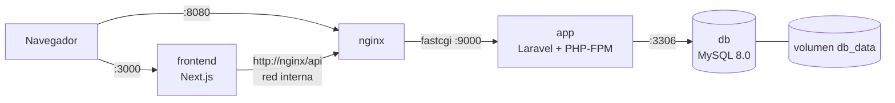

# Tienda E-commerce con Docker

Ecosistema de tres servicios (frontend, API y base de datos) preparado para producción con **Dockerfiles multi-stage**, imágenes ligeras y un único `docker-compose.yml` que lo levanta todo con un solo comando.

## Descripción general

Es una tienda en línea con catálogo, registro e inicio de sesión, carrito, órdenes y pagos con Stripe (modo de prueba). Las aplicaciones se desarrollaron durante el bootcamp y este repositorio las empaqueta para que se ejecuten igual en cualquier computadora.

| Servicio | Tecnología | Imagen base | Puerto |
|---|---|---|---|
| Frontend | Next.js 16 (App Router) | `node:20-alpine` | 3000 |
| API | Laravel 12 + PHP-FPM 8.2 | `php:8.2-fpm-alpine` | 9000 (interno) |
| Servidor web | Nginx (proxy inverso hacia PHP-FPM) | `nginx:alpine` | 8080 → 80 |
| Base de datos | MySQL 8.0 | `mysql:8.0` | 3306 (solo red interna) |

## Arquitectura de contenedores



- Todos los servicios comparten una red privada de Docker (`backend_net`) y se encuentran por nombre (`db`, `app`, `nginx`).
- **MySQL no publica ningún puerto al host**: solo `app` puede conectarse a él.
- Los datos de MySQL viven en un volumen con nombre (`db_data`), por lo que sobreviven a `docker compose down`.
- El navegador solo habla con dos puertos: `3000` (la tienda) y `8080` (la API y su documentación Swagger).

## Estructura del repositorio

```
tienda-docker/
├── frontend/              # Next.js + Dockerfile + .dockerignore
├── backend/               # Laravel + Dockerfile + .dockerignore
├── nginx/default.conf     # Configuración del proxy inverso
├── docs/                  # Capturas
├── docker-compose.yml
├── .env.example
└── README.md
```

## Cómo ejecutarlo

**Requisitos:** Docker Desktop (o Docker Engine con Compose v2) y Git.

### 1. Clonar el repositorio

```bash
git clone https://github.com/Ronii08/tienda-docker.git
cd tienda-docker
```

### 2. Crear el archivo `.env`

```bash
cp .env.example .env        # Windows PowerShell: Copy-Item .env.example .env
```

Abre `.env` y completa los valores. Cada variable está documentada en `.env.example`.

- Cambia las contraseñas de MySQL por unas propias.
- Para las claves de **Stripe** usa siempre claves de **prueba** (`sk_test_...` y `pk_test_...`).
- Genera `APP_KEY` y `JWT_SECRET` con estos comandos (no requieren nada instalado aparte de Docker):

```bash
# APP_KEY (pegar el resultado completo, incluido "base64:")
docker run --rm php:8.2-cli-alpine php -r "echo 'base64:'.base64_encode(random_bytes(32)).PHP_EOL;"

# JWT_SECRET
docker run --rm php:8.2-cli-alpine php -r "echo bin2hex(random_bytes(32)).PHP_EOL;"
```

### 3. Levantar todo

```bash
docker compose up -d --build
```

La primera vez tarda varios minutos (descarga imágenes y compila). MySQL tarda unos segundos en estar listo; `app` espera a que su *healthcheck* pase.

### 4. Crear las tablas y cargar datos de prueba

```bash
docker compose exec app php artisan migrate --force
docker compose exec app php artisan db:seed --force     # opcional
```

### 5. Abrir la aplicación

| URL | Qué es |
|---|---|
| http://localhost:3000 | Tienda (frontend) |
| http://localhost:8080/api/products | API REST |
| http://localhost:8080/api/documentation | Documentación Swagger |

### Comandos útiles

```bash
docker compose ps                  # estado de los servicios
docker compose logs -f app         # logs del backend
docker compose down                # apagar (conserva los datos)
docker compose down -v             # apagar y BORRAR la base de datos
```

## Imágenes resultantes

| Imagen | Tamaño en disco | Tamaño comprimido |
|---|---|---|
| frontend (Next.js) | 260 MB | 64 MB |
| app (Laravel + PHP-FPM) | 193 MB | 41.1 MB |
| nginx:alpine (oficial) | 103 MB | 29.7 MB |
| mysql:8.0 (oficial) | 1.1 GB | 249 MB |

todo se encuentra en la carpeta de screenshots

## Decisiones técnicas

### Frontend (`frontend/Dockerfile`)

Build multi-stage de tres etapas:

1. **`deps`**: copia solo `package.json` y `package-lock.json` y ejecuta `npm ci`. Mientras las dependencias no cambien, Docker reutiliza esta capa desde la caché y los builds son rápidos.
2. **`builder`**: copia el código y ejecuta `next build`.
3. **`runner`**: imagen limpia basada en `node:20-alpine` que contiene únicamente lo necesario para ejecutar la app.

Decisiones puntuales:

- **`output: "standalone"`** en `next.config`: Next genera un paquete mínimo con solo los archivos que usa en producción, sin llevar todo `node_modules`. La app se inicia con `node server.js`.
- **Usuario no-root** (`USER node`): si alguien explotara una vulnerabilidad, tendría permisos limitados dentro del contenedor.
- **Alpine** como base: menos paquetes, imagen más pequeña y menor superficie de ataque.
- **Versión fijada** (`node:20-alpine`) para que el build sea reproducible.
- **`.dockerignore`**: excluye `node_modules`, `.next`, `.git` y los `.env`, para no copiar archivos innecesarios ni filtrar secretos.
- La URL de la API que usa el servidor de Next se entrega en **tiempo de ejecución** con la variable `API_BASE_URL` (en el compose apunta a `http://nginx/api`), de modo que la misma imagen sirve para distintos entornos sin reconstruirse.

### Backend (`backend/Dockerfile`)

Build multi-stage de dos etapas:

1. **`vendor`**: usa `php:8.2-cli-alpine` con Composer copiado desde su imagen oficial. Instala las dependencias con `composer install --no-dev` y genera el autoloader optimizado. Composer y sus herramientas **no llegan a la imagen final**.
2. **`runtime`**: `php:8.2-fpm-alpine` con la extensión `pdo_mysql` y `opcache`, el código de la aplicación y la carpeta `vendor/` copiada desde la etapa anterior.

Decisiones puntuales:

- **Misma versión de PHP en ambas etapas (8.2)**: se descubrió que la imagen `composer:2` trae PHP 8.5, incompatible con la librería JWT del proyecto. Instalar las dependencias contra la versión real de ejecución evita ese tipo de errores.
- **PHP-FPM + Nginx en contenedores separados**: cada contenedor hace una sola cosa. Nginx atiende HTTP y entrega las peticiones PHP a FPM por el puerto 9000.
- **Extensiones requeridas**: `mbstring`, `openssl`, `tokenizer`, `xml`, `ctype` y `json` ya vienen incluidas en la imagen oficial de PHP; solo se instalan `pdo_mysql` y `opcache`. Se verifica con `docker run --rm <imagen> php -m`.
- **`php.ini-production`**: configuración recomendada de PHP para producción.
- **Permisos**: las carpetas `storage/` y `bootstrap/cache/` pertenecen a `www-data`, el usuario con el que corren los procesos de PHP-FPM.
- **`.dockerignore`**: excluye `vendor`, `.env`, logs y, de forma importante, `bootstrap/cache/*.php`. Esa caché se generaba en la máquina de desarrollo e incluía paquetes de desarrollo (como Laravel Pail) que no existen en la imagen de producción, lo que rompía el arranque.
- **Configuración por variables de entorno**: `APP_ENV=production`, `APP_DEBUG=false` y los secretos (`APP_KEY`, `JWT_SECRET`, claves de Stripe, credenciales de la base de datos) se entregan desde el compose y nunca viven dentro de la imagen.
- **Logs a `stderr`** (`LOG_CHANNEL=stderr`): se consultan con `docker compose logs`.

### Base de datos (`mysql:8.0`)

- Imagen oficial, sin Dockerfile propio.
- Configurada con `MYSQL_ROOT_PASSWORD`, `MYSQL_DATABASE`, `MYSQL_USER` y `MYSQL_PASSWORD`; el compose falla con un mensaje claro si falta alguna.
- Volumen persistente `db_data` montado en `/var/lib/mysql`.
- **Sin `ports:`**: el puerto 3306 solo existe dentro de la red de Docker.
- *Healthcheck* con `mysqladmin ping`; `app` usa `depends_on` con `condition: service_healthy` para esperar a que MySQL esté listo.
- Existe una línea comentada en el compose para montar un script SQL opcional en `/docker-entrypoint-initdb.d/`.

### Nginx

Se usa la imagen oficial `nginx:alpine` con un único archivo de configuración montado en modo solo lectura. Solo expone la carpeta `public/` de Laravel, pasa los `.php` a `app:9000` y bloquea el acceso a archivos ocultos (`.env`, `.git`).

## Problemas encontrados y cómo se resolvieron

| Problema | Causa | Solución |
|---|---|---|
| `composer install` fallaba en el build | `composer:2` traía PHP 8.5 y la librería JWT exige 8.1/8.2 | Etapa de build con `php:8.2-cli-alpine` y Composer copiado desde su imagen |
| `app` se reiniciaba en bucle (`php-fpm: not found`) | La imagen final era `cli`, que no incluye PHP-FPM | Completar la etapa final con `php:8.2-fpm-alpine` |
| `Class "Laravel\Pail\PailServiceProvider" not found` | La caché de Laravel generada en desarrollo viajó a la imagen | Excluir `bootstrap/cache/*.php` en `.dockerignore` |
| El catálogo no cargaba | Dentro de un contenedor, `localhost` es el propio contenedor | El frontend llama a la API por el nombre del servicio: `http://nginx/api` |
| `Secret is not set` al iniciar sesión | `JWT_SECRET` vivía en un `.env` que no entra a la imagen | Entregarlo como variable de entorno desde el compose |
| El `push` a GitHub fallaba (HTTP 408) | La caché de desarrollo `.next/` (un archivo de 116 MB) entró al commit | Corregir el `.gitignore` y sacar `.next/` del seguimiento |

## Seguridad

- Los secretos (`.env`) nunca se suben al repositorio: solo se versiona `.env.example`.
- Los secretos no se copian a las imágenes; se entregan en tiempo de ejecución.
- Imágenes Alpine con versiones fijadas y builds multi-stage para llevar solo lo necesario.
- El frontend corre como usuario no-root.
- MySQL no es accesible desde fuera de la red de Docker.
- Se usan exclusivamente claves de **prueba** de Stripe.

## Limitaciones conocidas

- El formulario de pago de Stripe solo se muestra correctamente después de recargar la página. Parece un tema del frontend y no de la contenerización, y queda pendiente de revisar.
- El proyecto está pensado como entorno de producción *local*: no incluye HTTPS ni un proxy con certificados. Para un despliegue público habría que agregarlos.
